# Project Summary — Verifiable NL Analytics across v1, v2, v3

*A single-file, figure-led synthesis of the whole project: what each system does, what its data looks
like, the techniques used and **why**, the results and **why they came out that way**, how the approach
**evolved** across the three versions, and the strengths, limitations and future work. Every figure is
rendered from the project's own data or verified numbers by the scripts in
[`tools/`](tools/) — they visualise results, they invent nothing. For the long form, see the sibling files
in this folder ([01_systems_and_data](01_systems_and_data.md) ·
[02_techniques_and_rationale](02_techniques_and_rationale.md) ·
[03_results_and_findings](03_results_and_findings.md) ·
[04_limitations_and_future_work](04_limitations_and_future_work.md)).*

---

## The one idea, held constant

Everything in this project is a single architecture applied to three very different kinds of data. The
data layer changes; nothing else does.

```
preprocess → detect (stat · ML · deep) + evaluate → QUERY ENGINE (truth) → reason · RAG · LLM → interface/apps
```

> **Computation = deterministic code (the "truth layer"); the language model only *explains*; and an
> automated *faithfulness check* rejects any answer that introduces a number not present in the computed
> facts.**

I call this pattern **Verifiable NL Analytics**. A language model that is confidently wrong about a figure
is worse than no answer, because it *reads* as authoritative — so the numbers are never the model's job. A
deterministic query engine computes every statistic with exact pandas operations; a separate
`verify_results.py` harness re-computes the headline results independently; a local Ollama model is allowed
only to *reword* those already-correct figures; and a faithfulness gate checks the prose back against the
facts. Answers carry visible trust labels — 🔢 *computed*, 📚 *context*, 🧠 *inferred*. The whole stack runs
offline. The project is, at heart, an argument that this pattern is **domain-agnostic**, and that **honest
evaluation matters more than model complexity**.

The three versions were chosen to be maximally different — physical, economic, cyber — and to climb a
deliberate ladder of label quality: **synthetic → real-but-coarse → real-and-fine**. The sections below
walk each system through five figures, then draw the cross-cutting conclusions.

---

## The three datasets, explained (plain language)

Before the results, a plain-English tour of the three datasets — what each one *is*, where it comes from,
what a single row means, and what counts as an "anomaly" in it. All numbers below are measured from the
actual files, not quoted from memory.

### v1 — Jena Climate (weather)

**What it is.** Eight years of weather readings from a single automatic station run by the Max Planck
Institute in Jena, Germany. It is a well-known public teaching dataset (widely mirrored, e.g. on Kaggle).
**What a row is.** One moment in time with **14 sensors** attached — temperature, air pressure, humidity,
dew point, several vapour-pressure measures, wind speed and direction, and air density. The headline sensor
is air temperature, `T (degC)`.
**Size.** The raw file has **420,551 readings taken every 10 minutes** from 1 Jan 2009 to 1 Jan 2017;
preprocessing averages these to **70,129 hourly rows**. Temperature runs from **−22.65 °C to +37.04 °C**
(mean 9.44). The hottest day is **4 Jul 2015**, the coldest **6 Feb 2012**.
**What an anomaly is.** An unusual weather moment or a sensor glitch. Jena ships with **no labels**, so v1
must *inject* known anomalies to measure detection (figure v1-5).
**Quirks the code handles.** The two wind columns contain **38 `-9999` sentinel error codes** (18 + 20)
that must be cleaned before anything else; after cleaning there is **0 % missing** data. Because temperature
crosses 0 °C, percentage error metrics (MAPE) are unsafe and MASE is used instead.

### v2 — EU international trade (economics)

**What it is.** Official monthly trade figures for the 27 EU countries, published by **Eurostat** (the EU's
statistics agency) and fetched through its public API. This is real-world economic data, not a benchmark.
**What a row is.** One **month**, with a column for every country's **exports** and every country's
**imports** — **27 countries × 2 = 54 columns**, all in **€ millions**, *not* seasonally adjusted (so the
natural seasonality and the real shocks both survive in the numbers).
**Size.** **292 months**, January 2002 to April 2026. Total EU trade grew from about **€382 bn/month** in
2002 to a peak of **€1,281 bn** in September 2022, standing near **€1,188 bn** at the end.
**What an anomaly is.** A real, datable economic shock. The ground truth is *crisis windows*: the **2008
financial crisis** (a ~35 % peak-to-trough fall in EU trade), **COVID-2020** (trade fell ~27 % between
February and April 2020 — figure v2-5), and the **2022 energy crisis**.
**Quirks the code handles.** Labels are real but *coarse* (whole crisis months, not exact points), and 292
monthly points is little data — which is why the deep model struggles here and simple detectors do well.

### v3 — DAD data-centre IoT network (security)

**What it is.** The **DAD dataset** (Vigoya, Fernández, Carneiro & Cacheda, 2020, published in *Sensors*):
a week of real network traffic from a data-centre cooling network, where temperature sensors report to a
central broker over the **MQTT** messaging protocol, and a security researcher injected real attacks. It is
captured as raw network-packet files (`.pcap`).
**What a row is.** One **network packet**, from which the pipeline extracts the source IP and port, the MQTT
topic, the temperature carried in the message, a message ID, and the attack label.
**Size.** **7 days** (20–27 Oct 2019), **101,583 packets** across just **5 IP addresses**, with **16
temperature sensors** publishing every **5 minutes** — **32,288 temperature readings** in all, ranging
**8.7 °C to 29.4 °C**.
**What an anomaly is.** A network attack on the sensor messages. There are **544 human-labelled attack
packets** in three kinds — **modification** (104: the reading is tampered with), **duplication** (56:
messages are replayed), and **mixed** (384: attack types interleaved). All attacks come from one attacker
IP, **`10.6.56.41`**, on a fixed weekly schedule (Wed/Thu/Fri/Sat; figure v3-1).
**Quirks the code handles.** These are **real per-packet labels** — v3's whole reason for existing — but the
classes are *severely imbalanced*: **185 : 1** by packet, **21 : 1** by 5-minute window. The imbalance is
respected (never resampled); imbalance-aware *metrics* are used instead. The authors also note the normal
traffic is "semi-synthetic" (generated from an STL model), so it is one data centre, one week, one attacker.

**The common thread.** Read together, the three are a deliberate progression in one respect — *how good the
labels are*. v1's anomalies are **injected** (no natural labels), v2's are **real but monthly-coarse**, and
v3's are **real and per-packet**. That single axis — label quality — is the spine of the whole project, and
the reason the systems are numbered in that order.

### What each system can already answer from its data (real, computed)

To make "what you can use the data for" concrete, here are genuine questions each interface answers today —
every figure below is computed by the deterministic query engine from the real files (🔢), not by the LLM:

- **v1 (weather).** *"What was the hottest temperature?"* → **37.04 °C**. *"…the coldest?"* → **−22.65 °C**.
  *"Which was the hottest day?"* → **4 July 2015**. *"Were there anomalies in July 2014?"* → the injected /
  residual detector returns the flagged hours with a multi-sensor explanation.
- **v2 (trade).** *"When did EU trade peak?"* → **September 2022 (≈ €1,281 bn)**. *"How far did trade fall in
  COVID?"* → **≈ 27 %** (Feb → Apr 2020). *"Was 2008 an anomaly?"* → **yes**, flagged as a shared shock
  across countries.
- **v3 (security).** *"Which IP is the attacker?"* → **`10.6.56.41`**. *"How many attacks on Wednesday?"* →
  **104**. *"How many attacks in total?"* → **544**. *"What types were they?"* → **modification 104,
  duplication 56, mixed 384**.

Each answer arrives with a trust label and, if a local model is running, a plain-English rewording that is
faithfulness-checked so it cannot alter the number. This is the payoff of the whole architecture: the data
is *directly askable* in natural language, and the answer is *exact by construction*.

---

## v1 — Weather (Jena climate): the reference implementation

v1 runs on the Jena Climate dataset — **70,129 hourly rows across 14 physical sensors**, strongly seasonal
and with genuine data-quality problems. It is the richest version by method count, and the one whose single
weakness sets the agenda for everything after it: **Jena has no anomaly labels.**

**1 · Eight years of temperature — the seasonal signal.**
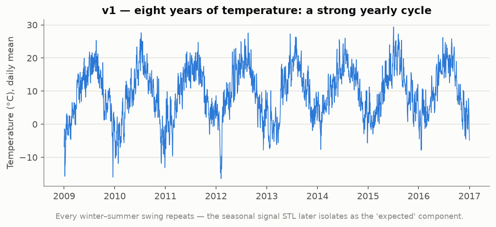
The daily-mean temperature over the full record shows an almost perfectly repeating winter–summer cycle.
This is the "expected" component STL later strips out so that anomalies can be sought in what remains — and
it is why every detector in v1 must be seasonality-aware rather than thresholding raw values.

**2 · The seasonal shape, quantified.**
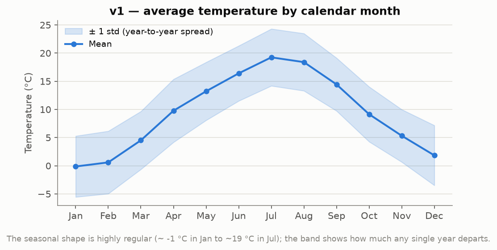
Averaging by calendar month makes the regularity explicit: roughly −1 °C in January rising to ~19 °C in
July. The shaded ±1 standard-deviation band shows how far any individual year departs from that mean — the
natural spread a detector must not mistake for an anomaly.

**3 · The distribution of temperature.**
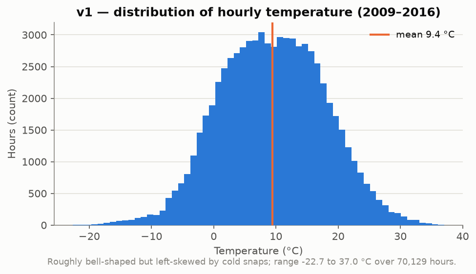
The full hourly distribution is broadly bell-shaped but left-skewed by cold snaps, spanning roughly −22 °C
to +37 °C. This matters for method choice: because the data crosses 0 °C, error metrics like MAPE are
avoided in the forecasting evaluation (division by near-zero), and MASE is used instead.

**4 · How the 14 sensors move together.**
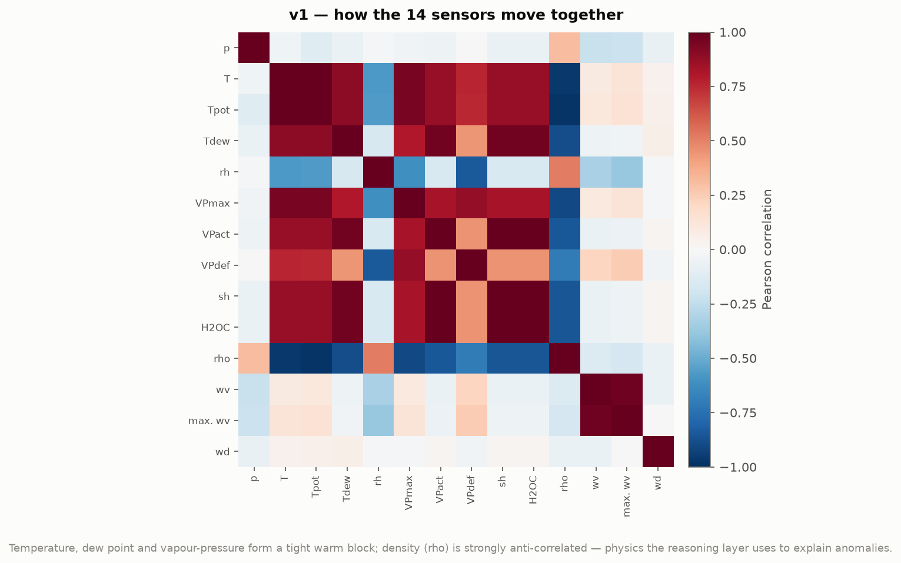
Temperature, dew point and the vapour-pressure family form a tight, strongly-correlated warm block, while
air density (`rho`) is strongly *anti*-correlated with them. This physical structure is exactly what v1's
reasoning layer exploits: when an anomaly appears, it can say *which* sensors moved together, distinguishing
a real weather event (many correlated sensors shift) from a single faulty sensor (one moves alone).

**5 · Detection, measured honestly on injected anomalies.**
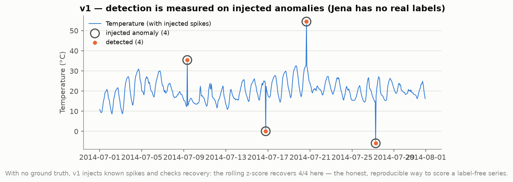
Because Jena has no ground truth, v1 measures detection the only honest way available: it **injects** known
synthetic spikes and checks how many the detector recovers. Here a residual-vs-median detector recovers all
four injected anomalies. This is the crux of v1's story — the pipeline works and the detectors are strong
(F1 up to ~1.00 on controlled signals), but the *strength of the claim* is capped by the fact that the
labels are synthetic. That cap is precisely what v2 was built to lift.

---

## v2 — Trade (EU international trade): real, datable anomalies

v2 runs on EU monthly international trade — **292 months × 54 country-flows**, 2002–2026. Its purpose is to
replace v1's synthetic labels with **real, datable** ones: the 2008 financial crisis, COVID-2020, and the
2022 energy crisis.

**1 · EU trade and its three real shocks.**
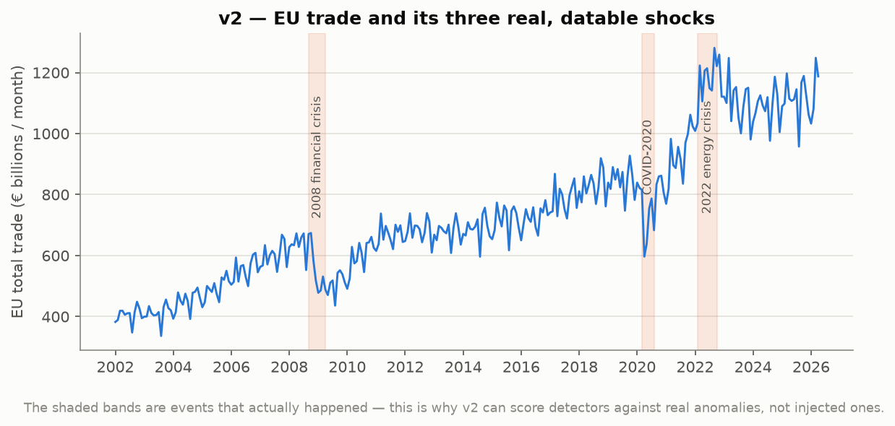
Total EU trade trends upward with strong monthly seasonality, and the three shaded bands mark events that
*actually happened*. Unlike v1, these are not injected — which is the whole point: v2 can score its
detectors against real anomalies. The 2008 and 2020 collapses are visible to the naked eye; 2022 shows up
as elevated volatility.

**2 · The seasonal shape of trade.**
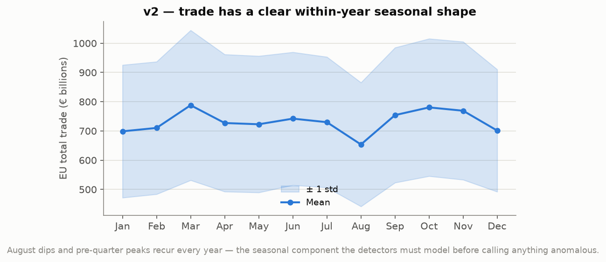
Trade has a pronounced within-year rhythm — a summer dip, end-of-quarter peaks — that repeats annually. As
in v1, a detector has to model this seasonal component first; otherwise every August would look like an
anomaly. This is why the anomaly score in the next figure is built on a *deseasonalised* signal.

**3 · The anomaly score lights up on the real crises.**
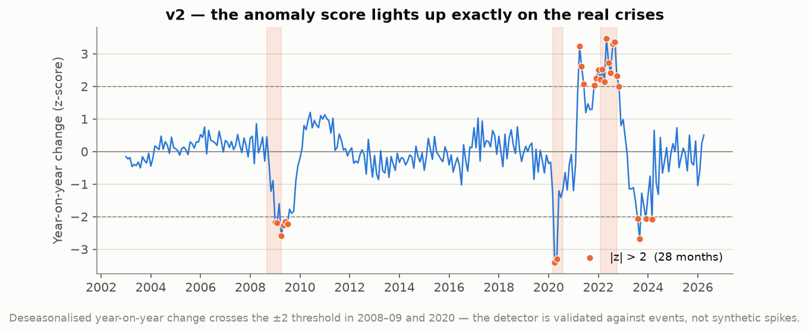
Taking the 12-month (seasonal) difference and standardising it gives a score that crosses the ±2 threshold
in exactly the right places: the 2008–09 collapse, the sharp 2020 COVID trough, and the 2021–22 rebound and
energy shock. This is the payoff of real labels — the detector is validated against events, not spikes we
drew ourselves.

**4 · A shared shock: every country falls at once.**
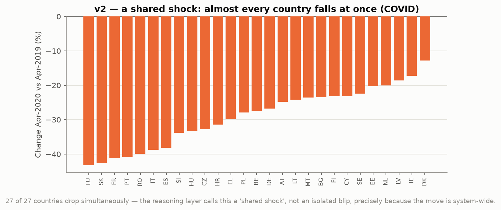
Comparing April 2020 with April 2019, **all 27 countries** contract simultaneously, several by 40%+. This is
the structure v2's reasoning layer is designed to name: a *shared shock* (a system-wide, correlated move) as
opposed to an *isolated* anomaly in one country. The breadth of the fall is what tells the system this is
macro, not local.

**5 · Forecasting, honest about what it cannot do.**
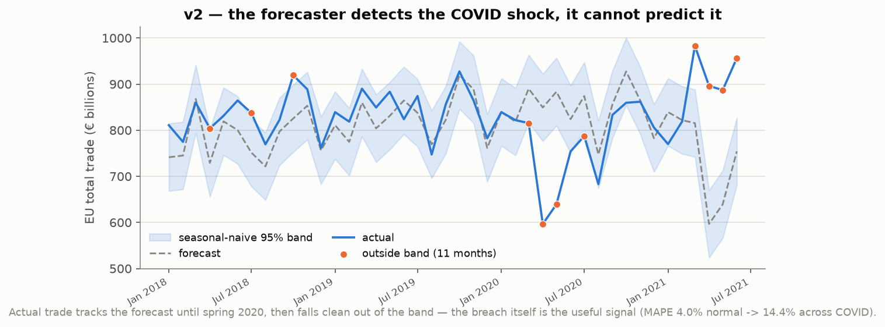
A seasonal forecast tracks actual trade closely through 2018–19 (backtest MAPE ~4%), then actual trade falls
**clean out of the 95% band** during spring 2020. The forecaster cannot *predict* an exogenous shock — but
the breach of its band is itself the useful signal. This is why v2 frames its forecaster as *detecting*, not
*predicting*, shocks (MAPE rises to 14.4% across COVID). v2's remaining limitation: the labels are real but
**coarse** (crisis months), and 292 monthly points is little data for a deep model — the gap v3 closes.

---

## v3 — IoT network security (DAD): real, per-packet labels

v3 runs on the DAD dataset — **seven days of MQTT sensor traffic (~101,583 packets)** parsed from raw pcaps,
shipped with **544 human-labelled attack packets** in three types. It is the strongest evaluation in the
project, and the only one where the anomalies split across two different signals, motivating a two-channel
detector and a fusion study.

**1 · The real attack schedule.**
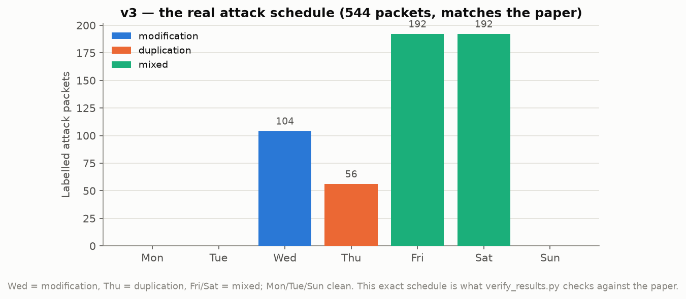
The 544 labelled attack packets fall on a precise weekly schedule — Wednesday is modification (104),
Thursday is duplication (56), Friday and Saturday are mixed (192 each), and Monday/Tuesday/Sunday are clean.
This exact breakdown is what `verify_results.py` checks against the paper: it is how we confirmed the
dataset is genuine and correctly parsed before trusting any downstream number.

**2 · Modification attacks distort the value channel.**
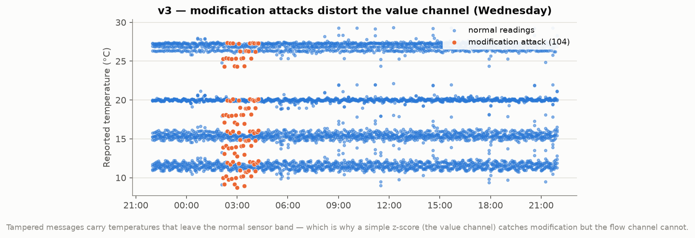
Plotting every Wednesday temperature reading, the normal messages form tight horizontal bands (one per
sensor); the modification-attack readings (orange), clustered in a short window, are scattered *off* those
bands into the gaps between them. A tampered reading reports a temperature its sensor never produced — which
is exactly why a simple z-score on the value channel catches modification, and why the flow channel (which
sees only timing and volume) cannot.

**3 · Why the flow channel is weak.**
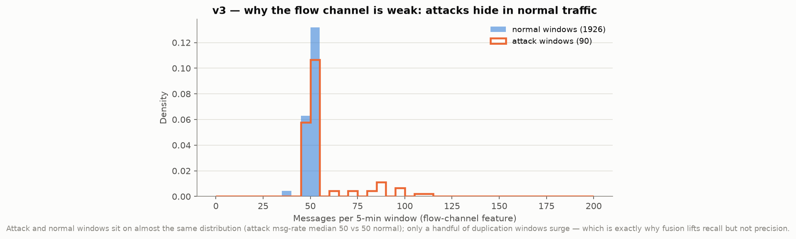
This is the honest counterpart to the previous figure. Comparing the flow feature (messages per 5-minute
window) between attack and normal windows, the two distributions sit almost on top of each other — attack
windows have a median message rate of 50, identical to normal. Only a handful of duplication windows surge
into the tail. The flow channel is genuinely weak on this data, and this overlap is the mechanical reason
fusion (next figures) buys recall but not precision.

**4 · The two channels are complementary.**
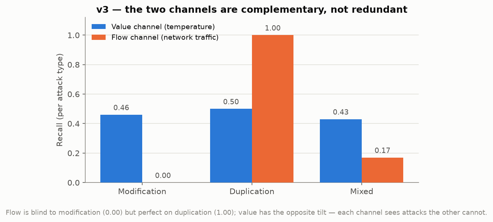
Per attack type, the channels are mirror images: the flow channel scores **0.00** recall on modification but
a perfect **1.00** on duplication, while the value channel has the opposite tilt. Each channel is blind to
the other's attack — a modification changes a value but not the timing, a duplication floods the timing but
each value looks plausible. This complementarity is the entire justification for combining them, and it is
only visible in the per-type breakdown, never in an aggregate score.

**5 · …but no configuration is significantly best.**
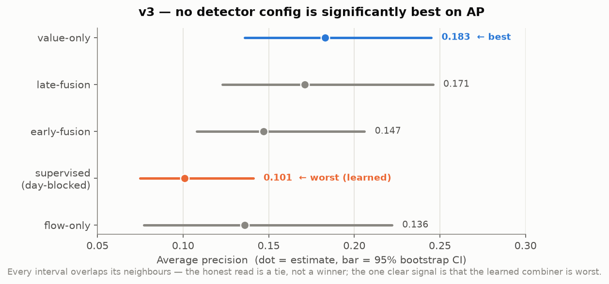
On the aggregate, threshold-free metric (average precision) with 95% bootstrap confidence intervals, the
value-only detector has the highest point estimate — but **its interval overlaps every other
configuration's**. There is no statistically distinguishable winner; the one clear signal is negative, that
the *learned* supervised combiner is the worst (day-blocked cross-validation exposes its overfitting to
day-confounded attack types). A point estimate alone would have declared a winner and overclaimed; the CIs
are what keep the result honest. Fusion's real merit shows only at the event level, where it reaches a
perfect 1.00 point-adjusted recall — it catches every episode, at a precision cost.

---

## The cross-cutting finding: simple beats complex, three times

Across all three domains, on a different metric each time, the deep or learned method never wins.

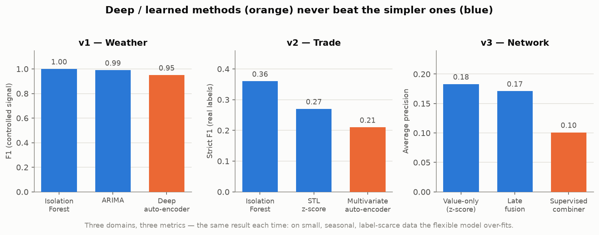

In v1 the deep autoencoder ties but does not beat Isolation Forest on the controlled signal; in v2 the
multivariate autoencoder (strict F1 0.21) clearly loses to Isolation Forest (0.36); in v3 the supervised,
learned score-combiner (AP 0.10) is the worst configuration of all. *Why this happens:* these datasets are
small, strongly seasonal, and label-scarce or label-clustered — exactly the regime where robust classical
detectors generalise and flexible learned models overfit. Deep models earn their keep on large, i.i.d.
data, which none of these three domains provide. The deep models were kept in anyway to *measure* the
trade-off rather than assume it: "we tried the sophisticated method, it didn't help here, and here is why"
is a stronger, more defensible result than either hype or omission.

Two more cross-cutting results complete the picture. First, **the architecture transferred** to all three
domains with only the data layer changing, and across every version the LLM introduced **0 fabricated
numbers** — because correctness is structural (computed upstream, re-checked downstream), not dependent on
the model being good. Second, **the real ladder was evaluation honesty, not model complexity**: the most
valuable progress across versions was better labels and better metrics (point-adjusted scores, bootstrap
CIs, per-type breakdowns, blocked CV), which is what let each version make a *defensible* claim.

---

## How the approach changed — the evolution ladder

The three versions are one argument, refined three times, where **each version was built to fix the
previous one's main weakness.**

v1 established the machinery on the hardest kind of *input* — a rich, messy, multivariate real signal — and
proved the whole pipeline worked end to end. But it could only measure detection against **synthetic**
anomalies (figure v1-5), because Jena has no ground truth. That single limitation set the agenda: no matter
how good the pipeline, the detection *claim* was capped by the *labels*.

So v2 did not chase a fancier model — it changed the **labels**. Moving to EU trade brought real, datable
anomalies (figure v2-1), giving the detectors external validity for the first time (figure v2-3), and the
correlated structure of those shocks motivated the shared-shock reasoning (figure v2-4). But v2's labels
were real yet **coarse** (crisis months), and the data was tiny — which both blunted the precision metric
and starved the deep model.

So v3 changed the **granularity**. The DAD captures provide real, per-packet labels (figure v3-1), and with
them came the most rigorous evaluation: per-attack-type recall (figure v3-4), point-adjusted metrics, and
bootstrap confidence intervals (figure v3-5). v3 is where the evaluation *itself* was stress-tested, not
just the models — and where the honest limits (a weak flow channel, figure v3-3) were measured rather than
hidden.

Read top to bottom, the through-line is unmistakable: the project climbed a ladder of **evaluation honesty**
— synthetic → real-coarse → real-fine — while the *same trust architecture rode on top, unchanged*. That is
the evidence the contribution is a reusable *method*, not a one-off system. Two smaller course-corrections
belong to the same spirit: v1's conversational follow-up logic was reworked to resolve **offline** after the
LLM-only path proved fragile without Ollama running; and v3's five-minute window size was adopted only after
a failing test revealed the true publish cadence — an evaluation decision *discovered by the tests* rather
than assumed.

---

## Techniques used, and why (in brief)

Every significant choice was made against a named alternative. The trust core: the query engine computes
numbers (not the LLM, which hallucinates); the LLM is explanation-only behind a faithfulness gate (which is
what makes a small 3B model safe); `verify_results.py` re-checks independently (not trusting the tests
alone); the model is local (not cloud) for privacy and offline use. Detection: Isolation Forest and z-score
as workhorses (not deep-by-default), STL to isolate seasonality, a *family* of detectors compared on one
harness, and — in v3 — a two-channel value+flow design with late (OR) fusion, deliberately **excluding the
attacker-IP feature** to avoid label leakage. Evaluation (the real backbone): average precision and F1 never
accuracy (meaningless at 21:1 imbalance), point-adjusted metrics alongside strict, bootstrap CIs, per-type
recall, day-blocked CV, no resampling of the imbalance, and filling value-channel gaps but not flow gaps
(a missing message *is* the interception signal). Engineering: scapy for pcaps (no sudo), an exact
`frame.number` label join, plain offline web UIs, and TDD throughout — a failing test even *discovered* the
5-minute cadence and a parser bug. The full technique-by-technique rationale is in
[02_techniques_and_rationale.md](02_techniques_and_rationale.md).

---

## Strengths

- **Verifiability by construction.** Numbers are computed, independently re-checked, and the LLM is gated,
  so a confidently-wrong figure cannot reach the user. Trust is made *legible*, not merely asserted.
- **Fully local, offline, private, zero-cost.** Python plus a local model; no cloud, air-gappable.
- **Domain-agnostic.** The identical design worked on physical sensors, macro-economics, and network
  security.
- **Honesty-first evaluation.** Real labels where they exist, event-level metrics, confidence intervals,
  per-type breakdowns, blocked CV — and negative results (deep models losing, a weak flow channel) reported
  openly rather than buried.
- **Reproducible and tested.** Test-driven throughout, `verify_results.py` trust gates, one-command
  reproduce scripts, and a newcomer `GETTING_STARTED.md` in each version.

## Limitations

- **Small local models** guarantee correct *numbers* but not correct *qualifiers* (adjectives, framing), and
  the gate tolerates small integers (≤ 12) — so a fabricated *small* count could in principle slip through.
- **Retrospective and batch**, not real-time or operational.
- **RAG is text-oriented** — raw sensor and pcap data must be summarised to markdown/CSV before indexing.
- **Per version:** v1's labels are synthetic; v2's are real but coarse with little data for deep models;
  v3's traffic is semi-synthetic, one data centre over seven days with one attacker, binary-labelled (71%
  only "mixed"), and severely imbalanced — with a genuinely weak flow channel (figure v3-3).

## Future work

1. **A unified multi-domain framework** — factor the shared truth layer, interface, and faithfulness gate
   into one installable package with three domain adapters, turning "three sibling systems" into "one
   framework, three adapters." The strongest research framing.
2. **Larger or fine-tuned local models** to reduce wrong *qualifiers*, and a **stronger faithfulness gate**
   that closes the small-integer gap (entity-aware checking of counts and IPs).
3. **Real-time / streaming detection** — move from batch to an operational monitor; all three domains have a
   live analogue.
4. **Better v3 detectors** — a seasonal value model, tuned Isolation-Forest contamination, a stronger flow
   channel, and more attack types and captures to enlarge the tiny per-type strata.
5. **Causal, not just correlational, reasoning**, and **cross-domain transfer** studies.
6. **A human evaluation** of the interface (task accuracy versus a spreadsheet, SUS, trust) and **on-prem
   hardening** of the offline Open WebUI + Ollama + GPU stack.

---

## Conclusion

Across weather, economics, and network security, a **deterministic truth layer + an explanation-only LLM + a
faithfulness gate** delivers **verifiable** natural-language analytics. The most durable lesson of the
project is not any single model but a discipline: **honest evaluation — real labels, event-level metrics,
confidence intervals, blocked cross-validation — matters more than model complexity**, and simple, robust
methods repeatedly match or beat complex ones on the small, seasonal, label-scarce data that real problems
actually provide.

---

*Reproduce the figures:* `cd code/v1 && python3.12 ../final_report/tools/make_v1_figures.py` (and likewise
`v2`, `v3`); `python3.12 tools/make_figures.py` for the cross-version chart. Each script loads the real
dataset (or the verified evaluation numbers) and writes into [`figures/`](figures/).
